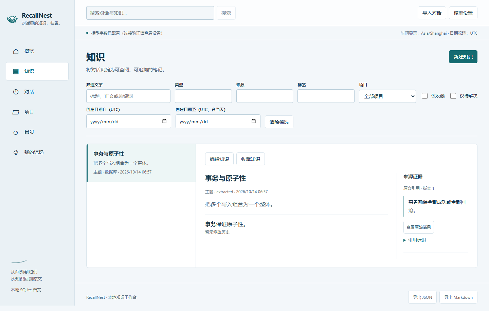

# RecallNest

[](https://github.com/wind127/recallnest/actions/workflows/ci.yml)

Keep your AI conversations as searchable knowledge, review material, project records, and personal memory with traceable sources.

[中文](README.md) · [Codex setup](docs/codex.md) · [Imports](docs/imports.md) · [Models](docs/models.md) · [CLI / MCP](docs/integrations.md) · [Deployment](docs/deployment.md) · [API contract](docs/api-contract.md)

RecallNest is a local, single-user application with a React workbench, FastAPI service, and SQLite archive. An optional OpenAI-compatible provider handles consolidation and chat. Import, text search, manual editing, and review also work without a model.

**Recommended: Codex organizes; RecallNest stores.** The bundled skill and MCP workflow use your existing Codex model/account, with no additional model API key and no copied login token. The web UI provides lookup, review and human memory confirmation. See [Codex setup](docs/codex.md).

## What it does

- Imports ChatGPT JSON/ZIP exports, Codex JSONL, normalized JSON, and Markdown. Preserves branches, raw records, and message versions with stable-ID replay handling.
- Archives in-app chat, captures an explicitly configured Codex directory, and accepts submissions through REST/MCP.
- Provides knowledge search, source citations, project grouping, favorites, and scheduled review cards.
- Builds memory candidates for preferences, background, goals, state, and constraints. You confirm, edit, reject, expire, or supersede them before active confirmed memories inform future answers.



Screenshots use synthetic conversations and fixed provider test responses. They show source citations and versions; see the [review and scheduling view](docs/images/review.png). They are not a benchmark of real model quality.

## Run locally

Requirements: Python 3.10+, [uv](https://docs.astral.sh/uv/), Node.js 22.12+, and npm.

```sh
git clone https://github.com/wind127/recallnest.git
cd recallnest
uv sync --locked
cd web
npm ci
npm run build
cd ..
uv run --locked python scripts/install_codex.py
uv run --locked recallnest serve --no-ai
```

Open <http://127.0.0.1:8787>. Import your files or explicitly load the labeled synthetic demo. RecallNest does not scan your history directories on first launch.

Setup requires the Codex CLI. It installs the user-level `$recallnest` skill and registers a local-only MCP server. Restart Codex, then ask it to organize the authorized backlog with `$recallnest`. Capture archives text; consolidation runs in Codex, not automatically after Codex closes.

For frontend development, run `npm run dev` inside `web/` alongside the API service. Vite proxies `/api` to the local backend.

### Installation prompt

```text
Install and connect https://github.com/wind127/recallnest using docs/codex.md. Set up the skill and MCP, and start the UI with --no-ai. Codex organizes using my existing allowance; RecallNest stores locally without an extra API key. Preserve existing data, verify the integration, and report the URL and restart instructions.
```

## Models and storage

Codex mode needs no provider configuration: `--no-ai` disables direct model calls and the provider worker. The optional standalone provider mode below uses `recallnest serve` without that flag. Do not run provider and Codex consolidation concurrently. Codex retains its existing account limits and billing; API-key-authenticated Codex retains its API billing.

Configure a compatible base URL, chat model, and optional API key in the settings view. An optional embedding model enables semantic retrieval. `.env.example` lists supported environment variables; copying it does not load those values automatically.

A base URL normally ends in `/v1`, for example an adapted local provider at `http://127.0.0.1:11434/v1`. Consolidation requires the model to return the requested JSON structure. A remote provider receives processed conversation text and selected context.

Persistent data defaults to `~/.recallnest`, configurable with `RECALLNEST_DATA_DIR`. Provider keys remain server-side and are excluded from API responses and archive exports. Secrets you put in source conversation text remain part of that source archive.

## Continuous capture and integrations

Preview an explicit Codex log directory before starting the background watcher. Replace these example paths with your log and private data directories:

```sh
uv run --locked recallnest capture preview --root "/path/to/codex-logs" --data-dir "/path/to/private-data"
uv run --locked recallnest capture start --root "/path/to/codex-logs" --data-dir "/path/to/private-data"
uv run --locked recallnest capture status --data-dir "/path/to/private-data"
uv run --locked recallnest capture stop --data-dir "/path/to/private-data"
```

Capture preserves raw records and versions, deduplicates replayed messages, and retries temporarily unreadable or changing files. Codex organizes the backlog through the skill. Only standalone provider consolidation requires `recallnest serve` with a configured provider. MCP, capture and the UI must share one data directory.

The stdio MCP server exposes seven tools: `search`, `fetch`, `context`, `submit`, `remember`, `prepare_consolidation`, and `complete_consolidation`. The last two accept host-generated knowledge, review cards and memory candidates with version-checked evidence. Context includes only active confirmed memories. See the [integration guide](docs/integrations.md).

Offline import and export are also available:

```sh
uv run --locked recallnest import examples/conversations.json
uv run --locked recallnest export --output recallnest-export.json
uv run --locked recallnest export --format markdown --output recallnest-export.md
```

## Scope

ChatGPT is supported through exports and explicit submissions; automatic web capture and browser extensions are future work. Memory retrieval supplies context rather than training model weights. Questions and assistant guesses do not establish user facts. Referenced media is archived as raw metadata without fetching or interpreting its pixels/audio.

Full JSON export preserves source versions, citations, and entity history; Markdown export is a readable text view. This release has no full archive restore endpoint, so back up the data directory for migration. The service binds loopback by default and has no public multi-user authentication.

## Development

```sh
uv run pytest -q
cd web
npm test -- --run
npm run build
```

[Contributing](CONTRIBUTING.md) · [Security](SECURITY.md) · [Verification](docs/verification.md) · [MIT license](LICENSE)

Product ideas were informed by Mem0, Khoj, Basic Memory, and Open WebUI. RecallNest is an independent implementation; see [design references](docs/design-references.md).
