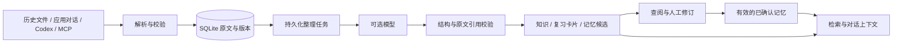

# 架构与数据流

RecallNest 把来源归档、模型整理和人工确认分成三个步骤。模型异常不影响已经归档的原文；人工确认决定哪些个人记忆可以进入后续回答。

## 目录职责

| 位置 | 职责 |
| --- | --- |
| `src/recallnest/importers.py` | ChatGPT、Codex、统一 JSON、Markdown 和 ZIP 解析 |
| `src/recallnest/db.py` | SQLite 表、写事务和一致性读快照 |
| `src/recallnest/repository*.py` | 来源、版本、实体、证据、记忆状态与复习记录 |
| `src/recallnest/models.py` | 输入契约、日期和字段校验 |
| `src/recallnest/ai.py` | 模型接口与结构化整理 |
| `src/recallnest/jobs.py` | 持久化任务、失败与恢复 |
| `src/recallnest/search.py` | 文本与可选向量检索 |
| `src/recallnest/routes/` | HTTP 入口 |
| `src/recallnest/cli.py`、`capture.py`、`mcp_server.py` | 命令行、目录采集与 MCP 接入 |
| `web/` | 查阅、对话、项目、复习、记忆和配置界面 |
| `tests/`、`web/e2e/` | 服务行为测试与真实服务上的浏览器测试 |
| `examples/` | 可以公开使用的合成资料 |

最终路由、请求和响应以 [API 契约](api-contract.md)为准。

## 为什么保留原文版本

整理结果引用的是某条消息的某个版本，不能仅保存一个会不断覆盖的字符串。消息被修改时，旧版仍供原有引用回查；界面可以告诉你来源已经变化。

导入通过来源身份和外部 ID 定位记录，没有 ID 的来源使用内容指纹。应用内对话和接入工具应提供稳定 ID，以区分消息追加、编辑和重试。会话分支保留在同一份归档中。

写入以 SQLite 事务完成。完整会话详情和 JSON 导出使用一致性读快照，避免一份响应混合并发写入前后的版本。

## 为什么记忆先是候选

用户提问不是用户能力证明，助手推断也不是用户本人陈述。模型整理必须带来源引用，个人记忆还要经过你确认，才能成为回答背景。记忆类别和状态见[记忆与复习](memory-and-review.md)。

旧背景被替代或失效后仍保留历史，检索上下文只使用当前有效的内容。模型没有因为这些记录而修改权重。

## 本地存储与可选模型

SQLite 是持久化来源；运行数据存放在仓库以外。模型连接配置和密钥属于服务端设置，不进入归档导出。向量索引为可选检索能力，不替代原文。

模型处理的文本会发送到你配置的接口。未配置模型时，导入、文本检索、手写知识、记忆管理和复习仍然可用。

完整 JSON 导出保存可核验的来源与派生历史；Markdown 导出方便阅读。首版没有完整归档恢复入口，运行状态迁移使用停机后的数据目录备份。
